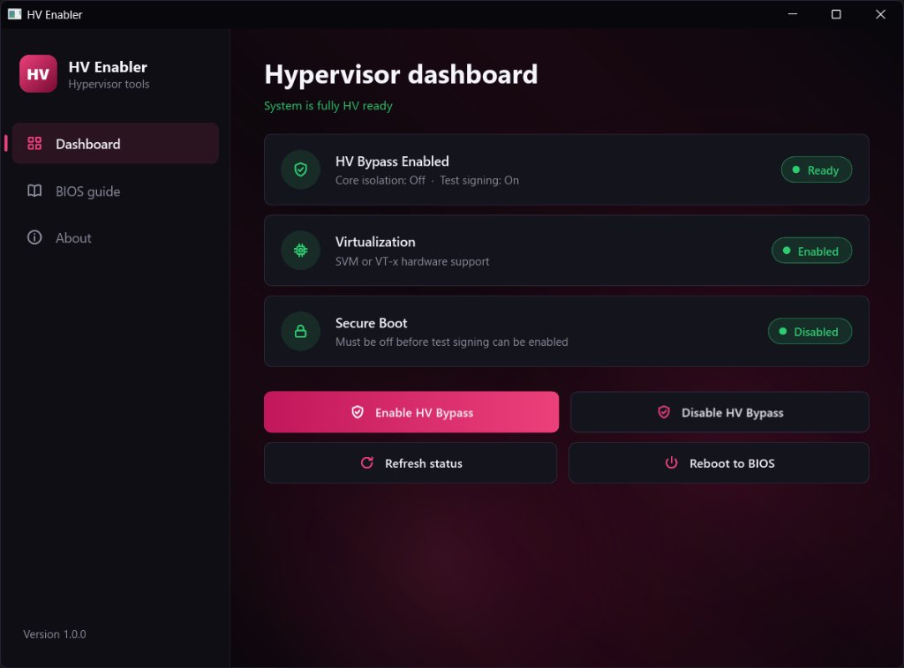
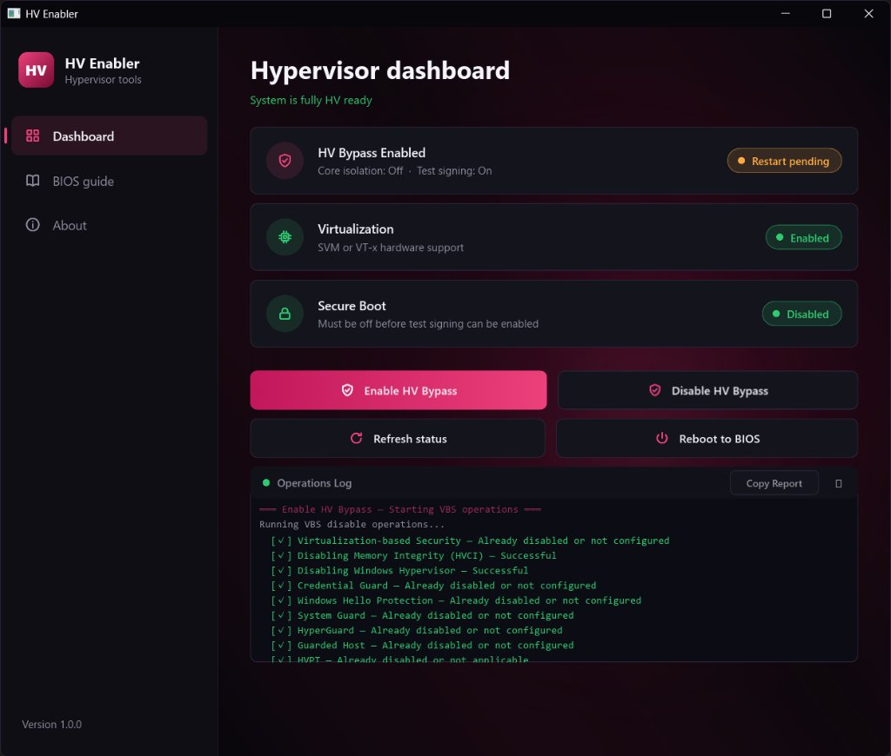

# HV Bypass Enabler

<div align="center">


<p align="center">
  <b>A utility to inspect, configure, and manage Hypervisor and Virtualization-Based Security (VBS) states.</b>
</p>

<p align="center">
  <a href="https://github.com/Dalipor/hv-bypass-enabler/releases/latest">
    
  </a>
</p>

</div>

---

## Interface Preview

<div align="center">

### Main Dashboard
*Real-time hardware virtualization status, Secure Boot detection, and single-click HV Bypass control.*



<br/>

### Live Operations Console
*Slide-out animated terminal streaming real-time registry and BCD modifications with one-click report export.*



</div>

---

## Features

- **Complete Hypervisor & VBS Bypass Pipeline**
  - Automates all system changes natively in Rust without relying on external scripts.
  - Toggles **Virtualization-Based Security (VBS)** and **Memory Integrity (HVCI)**.
  - Reconfigures **Windows Hypervisor launch parameters** across boot entries via BCD.
  - Disables conflicting virtualization security scenarios (**Credential Guard**, **System Guard**, **HyperGuard**, **Guarded Host**, **HVPT**, and **KVA Shadow**).

- **Clean Rollback & State Tracking**
  - Tracks previous configurations in `HKLM\SOFTWARE\ManageVBS`.
  - Reverting settings restores your system back to its exact original state and cleans up tracking keys.

- **Real-Time Operations Terminal**
  - Dropdown log console animated with smooth cubic-bezier transitions.
  - Live progress feedback with distinct color-coded indicators for successful, skipped, or failed steps.

- **One-Click Diagnostic Report**
  - Built-in **Copy Report** button instantly grabs a structured breakdown of every operation directly to your Windows clipboard.

- **Modern Fluent Aesthetics**
  - Inspired by the Windows 11 Settings app with an obsidian and neon-pink accent theme.
  - Pure vector path icons, dynamic radial glow backdrops, and hardware-accelerated rendering powered by **Slint**.

---

## Operations Breakdown

| Module | Target | Action on Enable | Action on Disable (Revert) |
|---|---|---|---|
| **VBS** | `DeviceGuard\EnableVirtualizationBasedSecurity` | `0` (Disabled) | Restored to `1` (if previously enabled) |
| **HVCI** | `Scenarios\HypervisorEnforcedCodeIntegrity` | `0` (Disabled) | Restored to `1` |
| **Hypervisor** | BCD `{current}`, `{hypervisorsettings}` | `hypervisorlaunchtype off` | Restored to saved launch type |
| **Credential Guard** | `Scenarios\CredentialGuard`, `Control\Lsa` | `0` (Disabled) | Restored to saved policy |
| **Windows Hello** | `Scenarios\WindowsHello\Enabled` | `0` (Disabled) | Restored to `1` |
| **System Guard** | `Scenarios\SystemGuard\Enabled` | `0` (Disabled) | Restored to `1` |
| **HyperGuard** | `Scenarios\HyperGuard\Enabled` | `0` (Disabled) | Restored to `1` |
| **Test Signing** | BCD Boot Configuration | `testsigning on` | `testsigning off` |

---

## Getting Started

### Prerequisites

- **Windows 10 (1903+) or Windows 11 (64-bit)**
- **Administrator Privileges** (required to manage BCD and HKLM registry hives)

### Building from Source

1. Install the official [Rust Toolchain](https://www.rust-lang.org/tools/install) (MSVC default recommended).
2. Clone this repository:
   ```powershell
   git clone https://github.com/Dalipor/hv-bypass-enabler.git
   cd hv-bypass-enabler
   ```
3. Compile the optimized release executable:
   ```powershell
   cargo build --release
   ```
4. Run the compiled application from an elevated shell:
   ```powershell
   .\target\release\hv-enabler.exe
   ```
   *(The application embeds an administrator execution manifest automatically via `build.rs`)*

---

## Repository Structure

```
hv-bypass-enabler/
├── assets/             # Screenshots and visual documentation assets
│   ├── dashboard.jpg
│   └── operations_log.jpg
├── src/
│   ├── main.rs         # UI state controller, thread scheduling & logging bridge
│   ├── sys.rs          # System probes (CPU virt, Secure Boot, clipboard, window styling)
│   └── vbs_ops.rs      # Native implementation of all 13 VBS / hypervisor operations
├── ui/
│   └── app.slint       # Vector UI layout, Fluent design tokens, animations & components
├── app.rc              # Windows application resource definitions
├── build.rs            # Slint compiler & administrator elevation manifest linker
├── Cargo.toml          # Rust package dependencies & configuration
└── README.md           # Project documentation
```

---

## Contributors & Credits

- **Dalipor** — Creator
- **Claude** — Core architecture, Slint UI layout & native VBS operations conversion
- **FitGirl-Repacks** — Reference logic and parameters derived from the `VBS.cmd` hypervisor management workflow

---

## License

This project is licensed under the [MIT License](LICENSE).
